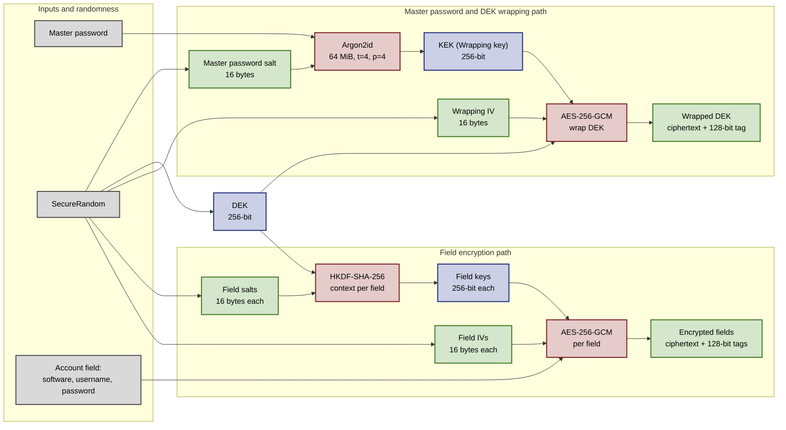

# Password Manager   

Password Manager is a secure and efficient application designed to manage locally stored accounts.  
In the current data format, each account's software details, username and password are encrypted at rest. The application is protected by a master password that the user must remember.

## Features

- **Add, modify, and delete accounts**: Manage your account information.
- **Encryption at rest**: Protect account data while it is stored locally.
- **Multilingual support**: Available in English and Italian, with more languages planned.
- **Simple, lightweight UI**: A dark theme and keyboard shortcuts keep common tasks quick.

## Installation

[Available Releases](https://github.com/Achille004/PasswordManager/releases)

Installer versions are standalone and include a bundled runtime environment.  
Portable versions require a Java Runtime Environment (JRE).

## Development

### Security

The goal is to follow applicable guidance, including NIST IR 8547 for post-quantum migration and CNSA 2.0 where relevant. This is an ongoing effort, not a compliance or certification claim.

NIST IR 8547 is post-quantum migration guidance; CNSA 2.0 targets U.S. National Security Systems.  
For this local vault, ML-KEM and ML-DSA are outside the scope because the vault neither exchanges keys nor signs vault data. Release signing and future synchronization are separate use cases.

#### Current cryptographic design

The current vault-write path is summarized below.

**Legend:** light gray = inputs; red = cryptographic operations; green = values stored in `data.json`; blue = in-memory values.

- **SecureRandom** is initialized lazily through `SecureRandom.getInstanceStrong()`, with `SecureRandom()` as a fallback if the named strong implementation is unavailable. It generates the DEK, salts and IVs; the application does not seed it manually. Strong-provider initialization may block on first use on some systems.
- **Legacy formats:** PBKDF2-HMAC-SHA-512 with 65,536 iterations is deprecated in the code and retained only to open older vaults. Old formats can contain a stored 512-bit password verifier (from Argon2id or PBKDF2); after successful authentication, the application upgrades the password protection to the current DEK-based format. Older account records may also keep software names and usernames in plaintext until those records are unlocked and migrated. Existing backups can retain older data until replaced.

Relevant references include [NIST FIPS 197 (AES)](https://csrc.nist.gov/pubs/fips/197/final), [NIST SP 800-38D (GCM)](https://csrc.nist.gov/pubs/sp/800/38/d/final), [RFC 9106 (Argon2)](https://www.rfc-editor.org/rfc/rfc9106.html), [RFC 5869 (HKDF)](https://www.rfc-editor.org/rfc/rfc5869.html), [NIST IR 8547](https://csrc.nist.gov/pubs/ir/8547/final), [NSA CNSA Suite 2.0](https://media.defense.gov/2025/May/30/2003728741/-1/-1/0/CSA_CNSA_2.0_ALGORITHMS.PDF), and [NIST SP 800-218 (Secure Software Development Framework)](https://csrc.nist.gov/pubs/sp/800/218/final). The project uses [Bouncy Castle](https://www.bouncycastle.org/)'s regular Java provider and lightweight API, plus Java's cryptography APIs for `SecureRandom` and legacy `PBKDF2`.

#### Current limitations

- The master-password strength bar is advisory; the application currently enforces only a non-empty password. Choose a strong, unique passphrase.
- The application currently accepts the master password as a `-p` / `--password` startup argument. Command-line arguments can be exposed through shell history or process-inspection tools, so this option should not be used with production vaults. A production build should compile this path out.
- The Argon2id parameters are not stored in the vault. Changing them requires a versioned format and migration so existing vaults remain readable.

### AI

_I deeply value transparency; it's part of open source, so I want to address the elephant in the room._

Yes, I'm currently using AI tools throughout development. Life is as busy as ever, and being the only developer can get overwhelming; with so much to do and so little time, I really appreciate having LLMs as a "second pair of eyes".  
I implement all the main features myself, but I often turn to AI for code reviews or to talk through how best to implement a feature, much like talking to a rubber duck.

On the other hand, most unit tests are AI-generated and manually reviewed and adapted. I take testing seriously, even though I wish I had more time to write the tests myself; AI helps with that repetitive work and lets me focus more on feature development and security.

## More information about the application

### Data storage

- **Windows**: `$USER_HOME/AppData/Local/Password Manager`
- **Other operating systems**: `$USER_HOME/.password-manager`

### Exporting data

The software previously supported exporting data to plain files, but this feature has been removed due to security concerns.  
A Google Drive integration is planned to replace this functionality, enabling users to securely transfer and manage their data. All synchronization operations will be performed on encrypted data, ensuring that plain data remains exclusively within the application.

## Contribution

All contributions are welcome. If you have a suggestion or bug report, or would like to contribute code, feel free to open an issue or submit a pull request in this repository.

## Contact

For any inquiries or support, contact me at 2004marras@gmail.com.
